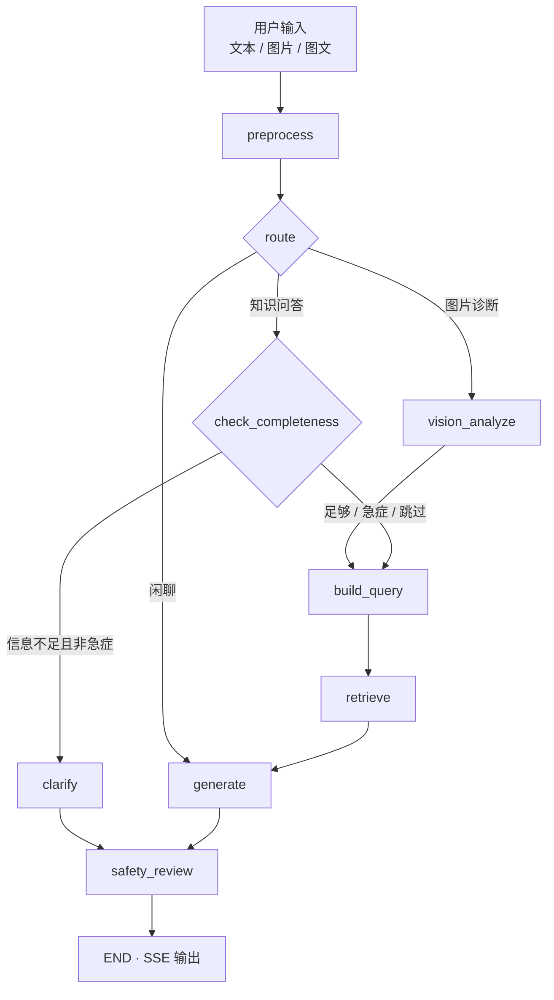

# 皮肤诊断智能体 · 需求描述

| 项 | 内容 |
|----|------|
| 系统名称 | 皮肤诊断智能体（Skin Diagnosis Agent） |
| 文档类型 | 需求描述（Requirements Description） |
| 版本 | v1.0 |
| 对应实现 | 仓库当前主干（backend + frontend） |
| 关联文档 | [系统设计文档](./系统设计文档.md) · [接口文档](./接口文档.md) · [追问澄清机制](./追问澄清机制.md) · [登录鉴权方案选型](./登录鉴权方案选型.md) |

> ⚠️ **定位声明**：本系统仅用于健康科普与初步参考，**不构成医疗诊断**，不能替代执业医师的面诊、检查与诊断。

---

## 1. 项目概述

皮肤诊断智能体是一套**本地化**的皮肤健康辅助系统，面向普通用户在出现皮肤问题时的日常咨询与初步判断场景。

系统将两件事串成一条链路：

1. **图像观察**——用多模态大模型（Qwen2.5-VL）对皮肤照片做形态学观察与方向性提示；
2. **知识检索**——用本地皮肤科知识库为结论补充可溯源依据。

最终输出结构化诊断卡片 / 科普回答，包含观察、可能方向、依据来源、护理要点与明确就医建议。

**技术形态**：`FastAPI + LangGraph + Chroma + SQLite + Vue 3`。  
**模型后端**：默认本机 `Ollama`（`qwen2.5vl:7b` + `bge-m3`），可切换为 OpenAI 兼容云端 API（`SKIN_LLM_BACKEND=cloud`）。

---

## 2. 背景与目标用户

### 2.1 业务痛点

普通用户面对皮肤问题时，痛点集中在三处：

| 痛点 | 表现 |
|------|------|
| **看不懂** | 不认识红斑、丘疹、水疱、鳞屑等皮损形态 |
| **判断不了轻重** | 不知道该居家观察、门诊还是急诊 |
| **找不到可信答案** | 网络信息鱼龙混杂，伪科普与营销内容混杂 |

### 2.2 目标用户

| 角色 | 典型场景 |
|------|----------|
| 普通用户 / 患者家属 | 皮肤起疹、脱屑、瘙痒，想先弄清方向、轻重、是否就医 |
| 知识库管理员 | 维护皮肤科科普语料，保证回答有据可查 |
| 部署方（内网 / 个人） | 需要数据可控、可离线运行的辅助工具 |

### 2.3 设计原则

1. **安全优先于信息完整**：急症永不追问，不因 AI 交互延误就医。
2. **图文不是并列功能，而是两阶段串联**：视觉结论驱动检索，知识依据反哺生成。
3. **能答就答，答不了说清楚**：单一依赖故障可降级，不整体失败。
4. **确定性规则兜底**：风险升级、免责声明、追问判定等关键分支不依赖模型自觉。
5. **隐私优先**：默认推理与数据不出内网。

---

## 3. 系统定位与边界

### 3.1 系统做什么

- 解读皮肤照片的形态学特征，给出**可能方向**与置信度；
- 基于本地知识库回答皮肤相关问题，并**引用来源**；
- 把图像观察与知识依据**融合**成一份有据可依的回答；
- 判断风险与危险信号，给出**明确就医建议**；
- 在信息不足时结构化追问，提高回答针对性。

### 3.2 明确不做什么

| 边界 | 说明 |
|------|------|
| 不下诊断结论 | 输出始终是「可能的方向」，措辞强制「倾向于 / 需排查」 |
| 不开处方、不给剂量 | 用药仅做方向性说明，引导就医 |
| 不替代面诊 | 无法触诊、皮肤镜、Wood 灯、病理检查 |
| 不处理非皮肤图像 | 检测到非皮肤部位时如实说明并降低置信度 |
| 不因 AI 结论延迟就医 | 风险等级达 `high` 及以上时，答案开头强制插入就医提示 |

---

## 4. 功能需求

### FR-1 知识库问答（RAG）

**目标**：对皮肤相关提问给出有来源依据的科普回答。

| 编号 | 需求项 | 说明 |
|------|--------|------|
| FR-1.1 | 文档入库 | 支持皮肤科文档解析、清洗、分块、向量化、元数据登记 |
| FR-1.2 | 混合检索 | 向量召回（跨用词差异）+ BM25 召回（专有名词）→ RRF 融合 → 可选 LLM 重排 |
| FR-1.3 | 带引用生成 | 回答基于检索结果生成，附来源列表（标题、片段、得分等） |
| FR-1.4 | 未覆盖降级 | 知识库为空或未命中时正常回答，并说明「现有资料未涵盖」，`sources` 为空 |
| FR-1.5 | 可关检索 | 支持 `use_knowledge=false` 走纯生成（便于对比与闲聊） |

### FR-2 图片识别（结构化视觉诊断）

**目标**：接收皮肤照片，输出结构化观察结果与疾病方向。

| 编号 | 需求项 | 说明 |
|------|--------|------|
| FR-2.1 | 图片接入 | 支持拖拽 / 粘贴 / 上传；base64 或 multipart |
| FR-2.2 | 图像预处理 | EXIF 矫正、缩放、亮度检查，非法格式直接拒绝且不消耗推理 |
| FR-2.3 | 结构化输出 | 产出部位、形态、颜色、分布、可能方向、置信度、备注等字段 |
| FR-2.4 | 语法约束与降级 | JSON Schema 约束输出；解析失败时三级降级，保证有可读结果 |
| FR-2.5 | 非皮肤检测 | 非皮肤部位如实说明，并降低所有置信度 |

### FR-3 图文融合（核心能力）

**目标**：图像结论与知识库依据合并为一份回答，而非两套独立逻辑。

| 编号 | 需求项 | 说明 |
|------|--------|------|
| FR-3.1 | 视觉驱动检索 | 视觉结构化结果映射为医学检索意图（疾病名、形态学术语） |
| FR-3.2 | 依据反哺生成 | 检索片段约束生成措辞，从「自由视觉描述」收敛到「有据可依的科普」 |
| FR-3.3 | 路径约束 | `vision_analyze` 之后必须经过 `build_query`，禁止视觉节点直跳 `generate` |
| FR-3.4 | 统一入口 | 纯文本 / 图片 / 图文汇流到同一张编排图，由 `route` 一处决定分支 |

### FR-4 追问澄清（信息完备性）

**目标**：用户信息过少时先追问再作答，避免泛泛检索。

| 编号 | 需求项 | 说明 |
|------|--------|------|
| FR-4.1 | 完备性判定 | 检索前插入闸门，判断是否具备足够判断维度 |
| FR-4.2 | 核心维度 | 出现时间、部位与范围、伴随感觉、变化趋势 |
| FR-4.3 | 补充维度 | 诱因、既往史、已处理（核心齐了才可能追问） |
| FR-4.4 | 确定性抽取 | 维度命中用正则 + 词典，不调用模型 |
| FR-4.5 | 结构化追问 | 输出已了解 / 待补充清单，前端以追问卡片展示 |
| FR-4.6 | 多轮进度 | 按会话保存已收集信息、待补字段、已用轮次 |

**四条不可动摇的约束：**

1. **急症永不追问**——出现危险信号立即作答并由安全层升级；
2. **仅个人症状咨询才追问**——通用知识问答不打扰用户；
3. **图片诊断不追问**——视觉已产出较充分维度，且契约为一次性诊断卡片；
4. **追问有上限**——默认最多 2 轮；用尽或用户要求直答时，转「带缺口的条件化作答」。

### FR-5 多轮对话与会话管理

| 编号 | 需求项 | 说明 |
|------|--------|------|
| FR-5.1 | 会话创建与复用 | `session_id` 可空新建，可复用保持上下文 |
| FR-5.2 | 历史注入 | 复用会话时注入最近若干轮历史，支持多轮 |
| FR-5.3 | 持久化与回放 | 会话列表、详情回放、删除 |
| FR-5.4 | 归属控制 | 会话与用户绑定（配合鉴权），客户仅见自己的历史 |

### FR-6 知识库管理

| 编号 | 需求项 | 说明 |
|------|--------|------|
| FR-6.1 | 文档上传入库 | 上传并登记，支持分类 |
| FR-6.2 | 文档列表与删除 | 查看已入库文档；删除文档及其向量 |
| FR-6.3 | 检索调试 | 不调 LLM 的检索接口 / CLI，便于调 RAG |
| FR-6.4 | 全量重建 | 更换 embedding 后可 `reindex` |
| FR-6.5 | 清空知识库 | 危险操作，需 `confirm=true` |
| FR-6.6 | 运维 CLI | `ingest / search / list / reindex / health` |

### FR-7 登录鉴权与用户管理

| 编号 | 需求项 | 说明 |
|------|--------|------|
| FR-7.1 | 角色模型 | 管理员 / 客户（及可扩展的禁用、待审等状态） |
| FR-7.2 | 登录会话 | 账号登录、登出、token 校验、过期与强制下线 |
| FR-7.3 | 权限控制 | 知识库写操作、用户管理、审计等仅管理员可执行 |
| FR-7.4 | 用户管理 | 创建 / 列表 / 改角色 / 禁用 / 删除 / 重置密码 |
| FR-7.5 | 审计日志 | 登录、危险操作、管理动作可追溯 |
| FR-7.6 | 会话隔离 | 客户仅访问自己的对话会话；管理员可见范围可配置 |

### FR-8 流式交互与系统可观测

| 编号 | 需求项 | 说明 |
|------|--------|------|
| FR-8.1 | SSE 流式 | 文本逐 token 输出 |
| FR-8.2 | 节点进度 | 如「正在分析图像…」「正在检索知识库…」「信息完备性判断」 |
| FR-8.3 | 追问事件 | 前端渲染结构化追问卡片 |
| FR-8.4 | 健康检查 | 组件就绪状态、degraded 原因与修复指引 |
| FR-8.5 | 模型与拓扑 | 模型能力列表、智能体图拓扑（Mermaid） |

---

## 5. 非功能需求

| 编号 | 类别 | 要求 | 指标 / 说明 |
|------|------|------|-------------|
| N1 | 本地化与隐私 | 默认全部推理在本地完成 | 图片与对话不出内网；云端模式须显式开启并告知 |
| N2 | 流式体验 | 快速首响应 | 文本首字延迟目标 ≤ 3s；阶段有节点级进度 |
| N3 | 鲁棒性 | 故障可降级 | Ollama 掉线、脏 JSON、空知识库、非法图片均有可读结果，不白屏 |
| N4 | 可维护性 | 分层清晰 | API → Agent → Services → Repositories 单向依赖；关键决策有注释 |
| N5 | 安全合规 | 不变量受保护 | 免责声明幂等；风险只升不降；危险信号确定性扫描 |
| N6 | 可测试 | 单测快速独立 | 不依赖 Ollama，秒级完成；模型效果评估另建标注集 |
| N7 | 可部署 | 多形态交付 | 本地开发、多容器 Docker、单容器云部署、云端 API 模式 |
| N8 | 可扩展 | 配置化 | 环境变量前缀 `SKIN_`；模型 / embedding / 路径可切换 |

---

## 6. 角色与权限

| 能力 | 管理员 | 客户 |
|------|:------:|:----:|
| 图文提问 / 知识问答 / 图片诊断 | ✅ | ✅ |
| 查看文档列表 | ✅ | ✅ 只读 |
| 检索调试 | ✅ | ✅ 只读 |
| 上传文档 | ✅ | ❌ |
| 删除文档 | ✅ | ❌ |
| 重建索引 | ✅ | ❌ |
| 清空知识库 | ✅ | ❌ |
| 用户管理 / 重置他人密码 / 强制下线 | ✅ | ❌ |
| 查看审计日志 | ✅ | ❌ |
| 查看对话历史 | 全部或仅自己（可配） | 仅自己 |
| 系统健康检查 / 模型列表 / 拓扑图 | ✅ | ✅ |

---

## 7. 核心业务流程

### 7.1 意图路由（优先级即顺序）

```
1. 会话带有效图片          → image_diagnosis
2. 寒暄 / 空输入           → chitchat
3. 皮肤关键词 或 追问中     → kb_qa
4. 其它                    → 默认知识问答 / 闲聊（按实现策略）
```

### 7.2 编排链路



**分支说明**：

- **图片诊断**：视觉分析 → 检索意图 → 检索 → 融合生成 → 安全审查；
- **知识问答**：完备性判断 →（追问 **或**）检索意图 → 检索 → 生成 → 安全审查；
- **闲聊**：直达生成 → 安全审查；
- **所有出口**必须经过 `safety_review`。

### 7.3 安全审查要点

1. 确定性危险信号扫描（本轮输入 + 累计信息）；
2. 风险等级**只上调不下调**；
3. 幂等追加免责声明；
4. `must_see_doctor` 时在回答显著位置插入就医提示。

### 7.4 追问判定优先级（摘要）

```
关闭追问 → 带图不问 → 危险信号不问（直接作答）
→ 用户要求直答不问 → 非个人症状不问
→ 核心维度已够不问 → 轮次用尽不问（兜底作答）
→ 否则追问，轮次 +1
```

---

## 8. 数据需求

### 8.1 数据分类

| 类别 | 内容 | 存储 |
|------|------|------|
| 知识语料 | 皮肤科科普 / 指南类文档 | 对象文件 + 向量库 + SQLite 登记 |
| 向量索引 | 分块向量与检索元数据 | Chroma |
| 会话数据 | 消息、标题、时间 | SQLite |
| 追问进度 | 已收集维度、待补字段、轮次 | SQLite `clarifications` |
| 用户与鉴权 | 账号、角色、登录会话、审计 | SQLite |
| 上传图片 | 用户皮肤照片 | 本地文件（默认不出内网） |

### 8.2 关键实体（逻辑）

- **Document**：`doc_id`、标题、来源、分类、入库时间  
- **Chunk**：归属文档、序号、正文片段、页码（可选）  
- **ChatSession**：`session_id`、标题、`user_id`、创建/更新时间  
- **Message**：角色、内容、时间、关联结构化结果（vision / sources / safety）  
- **Clarification**：按会话一行，JSON 保存 `collected` / `pending_fields` / `rounds`  
- **User / AuthSession / AuditLog**：账号、登录态、操作审计  

---

## 9. 接口需求（摘要）

**约定**：Base URL 默认 `http://127.0.0.1:8000`，前缀 `/api/v1`；JSON 为主，上传用 multipart，流式用 SSE。

| 模块 | 接口 | 用途 |
|------|------|------|
| 对话诊断 | `POST /agent/chat` | 统一入口（文本 / 图 / 图文，SSE 或 JSON） |
| 对话诊断 | `POST /chat/qa` | 知识库问答（忽略图片） |
| 对话诊断 | `POST /diagnosis/image` | 图片识别（multipart） |
| 知识库 | `POST/GET/DELETE /kb/documents[...]` | 入库、列表、删除 |
| 知识库 | `POST /kb/search` | 检索调试 |
| 知识库 | `POST /kb/reindex` · `POST /kb/reset` | 重建 / 清空 |
| 系统 | `GET /system/health` · `/models` · `/graph` | 状态、模型、拓扑 |
| 会话 | `GET/DELETE /sessions[...]` | 列表、回放、删除 |
| 鉴权 | `POST /auth/*` · 用户管理 | 登录、账号、审计（按落地范围） |

**SSE 事件类型（摘要）**：`meta` · `node` · `token` · `clarify` · `sources` · `vision` · `safety` · `done` · `error`。

**降级语义**：

| 故障 | 行为 |
|------|------|
| Ollama 不可达 | 503，消息含启动指引 |
| 视觉输出无法解析 | 降级纯文本，`errors` 说明 |
| 知识库空 / 未命中 | 正常回答并提示，`sources` 为空 |
| 检索异常 | 跳过检索直接生成，记录原因 |
| 图片非法 | 400，不消耗推理 |

详细字段、错误码与示例见 [接口文档](./接口文档.md)。

---

## 10. 安全与合规需求（不变量）

以下约束在任何重构中**不得破坏**，并有单测锁定：

| 编号 | 不变量 |
|------|--------|
| S1 | **免责声明**由代码幂等追加，不依赖模型记得书写 |
| S2 | **风险等级单调**：只上调、不下调 |
| S3 | **危险信号确定性扫描**：色素痣形态改变、破溃不愈、迅速扩大、发热、黏膜受累、呼吸困难等 → 强制就医提示 |
| S4 | **急症优先于信息完整**：追问不得延误就医 |
| S5 | **融合路径约束**：视觉结论不得绕过检索直接生成诊断式回答 |
| S6 | **出口全覆盖**：所有生成路径经过 `safety_review` |
| S7 | **公网部署警示**：需明示照片将离开本机，并具备鉴权与限流，否则与「数据不出内网」定位冲突 |

**合规表述要求**：

- 输出使用「倾向于 / 需排查 / 可能」等方向性措辞，禁止确诊式表述；
- 不提供处方与具体剂量；
- 高风险场景明确建议及时前往正规医疗机构就诊。

---

## 11. 部署需求

| 形态 | 适用 | 要点 |
|------|------|------|
| 本地开发 | 个人 / 内网开发 | Ollama + 后端 :8000 + 前端 :5173（`/api` 代理） |
| 多容器 Docker | 自有服务器 | API + 前端；Ollama 常驻宿主机便于 GPU |
| 单容器云部署 | 魔搭等单入口 PaaS | Ollama + API + 静态前端，固定端口 **7860**，数据挂持久化卷 |
| 云端 API 模式 | 小内存免费 PaaS | `SKIN_LLM_BACKEND=cloud`，不跑本地大模型 |

**运行依赖**：Python ≥ 3.11，Node ≥ 18；本地模式需可用的 Ollama 与已拉取模型（或等价云端配置）。

---

## 12. 验收要点

### 功能验收

- [ ] 纯文本皮肤问题：返回带来源的回答 + 免责声明
- [ ] 上传皮肤照片：结构化诊断卡片 + 融合依据 + 风险等级
- [ ] 图文混合：视觉结论参与检索与生成，非两段独立回答
- [ ] 信息不足的个人症状：结构化追问；补充后能正常作答
- [ ] 急症描述：不追问，直接警示就医，风险不降级
- [ ] 通用知识问题（如「湿疹怎么护理」）：不进行个人症状追问
- [ ] 会话多轮：上下文连贯，可回放与删除
- [ ] 知识库上传 / 删除 / 检索调试 / 重建 / 清空可用

### 非功能与安全验收

- [ ] Ollama 关闭：health 为 degraded 或接口 503，消息可读、不白屏
- [ ] 知识库为空：正常回答并提示未覆盖
- [ ] 模型吐脏 JSON：可降级解析或可读错误
- [ ] 风险规则：含危险信号时等级只升不降；免责声明不重复堆叠
- [ ] 更换 embedding 后执行 reindex，检索维度匹配
- [ ] 未登录 / 客户账号无法执行知识库写操作与用户管理
- [ ] 客户仅能查看自己的会话历史

---

## 13. 需求优先级建议

| 优先级 | 范围 |
|--------|------|
| **P0** | FR-1 知识库问答、FR-2 图片识别、FR-3 图文融合、FR-8 流式与健康检查、S1–S6 安全不变量 |
| **P1** | FR-4 追问澄清、FR-5 多轮会话、FR-6 知识库管理、N3 降级 |
| **P2** | FR-7 登录鉴权与审计、多角色权限矩阵、公网限流 |
| **P3** | 云端 API 模式完善、可选 LLM 重排调优、更细粒度审计与运营报表 |

---

## 14. 一句话需求

> 在隐私优先的前提下，用「视觉观察 → 知识检索 → 融合生成 → 安全兜底」的链路，帮普通用户看懂皮肤问题、判断轻重、找到可信科普，并在该就医时明确说就医——但绝不替代医生做诊断。
